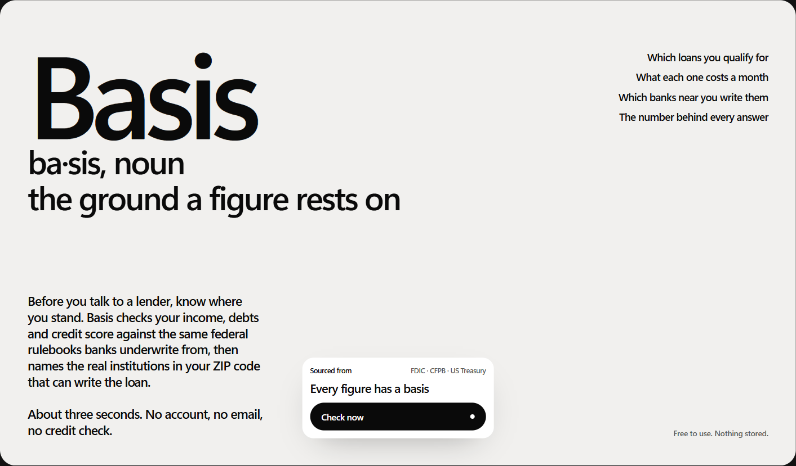
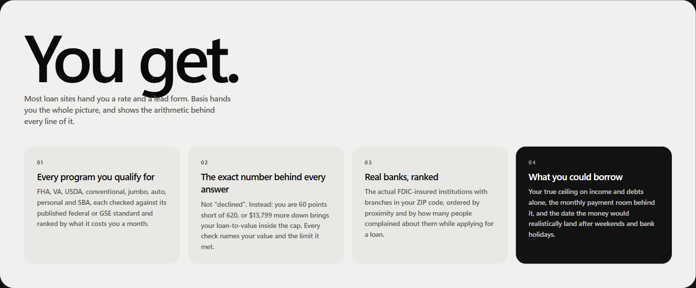
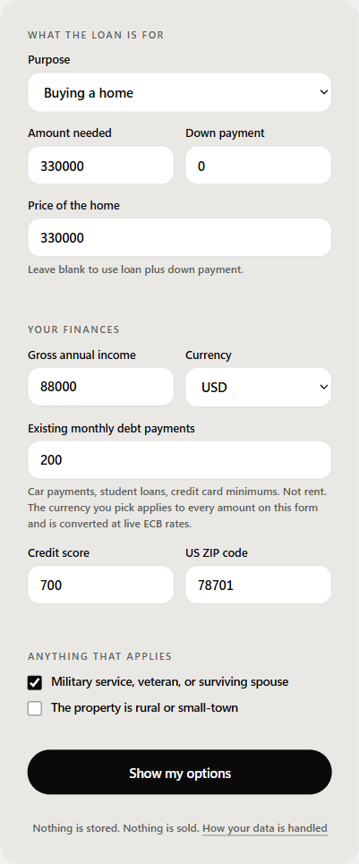
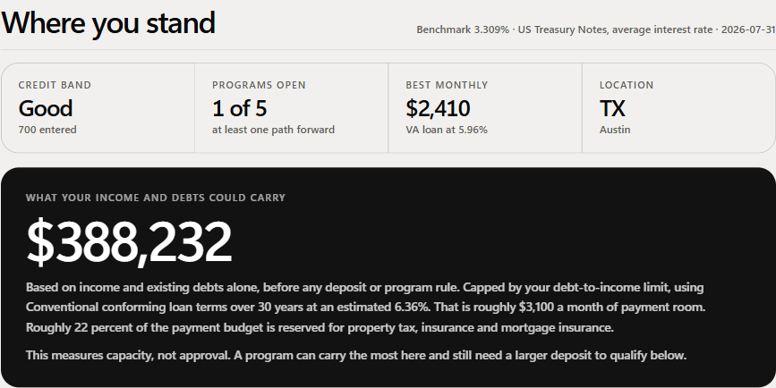
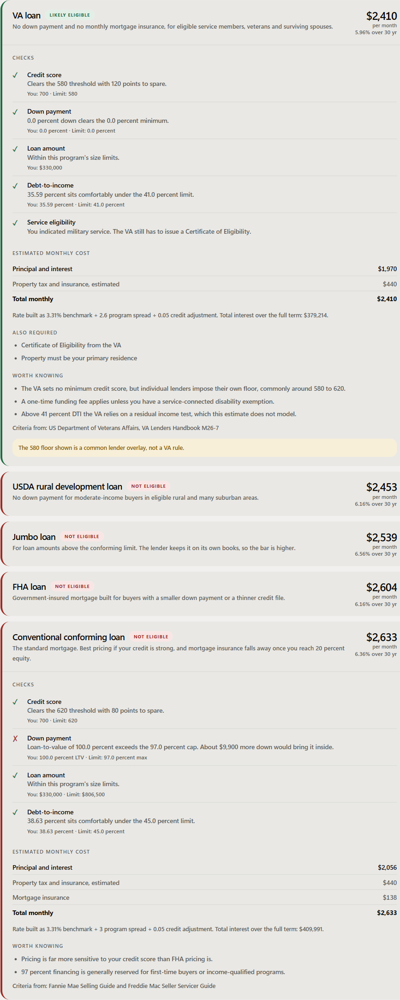
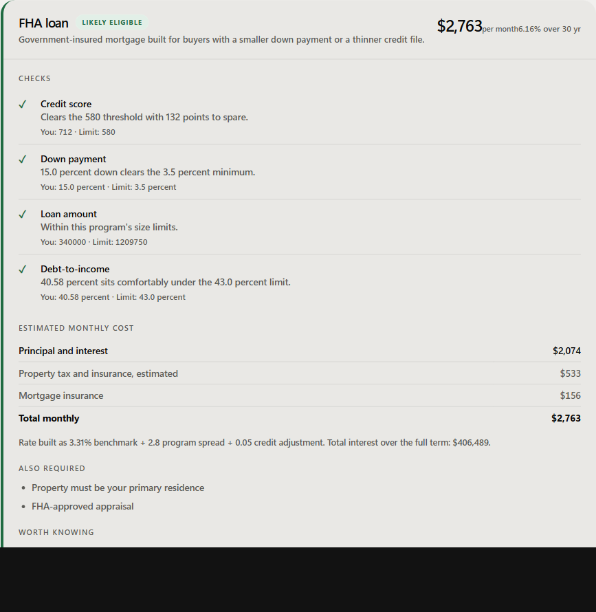
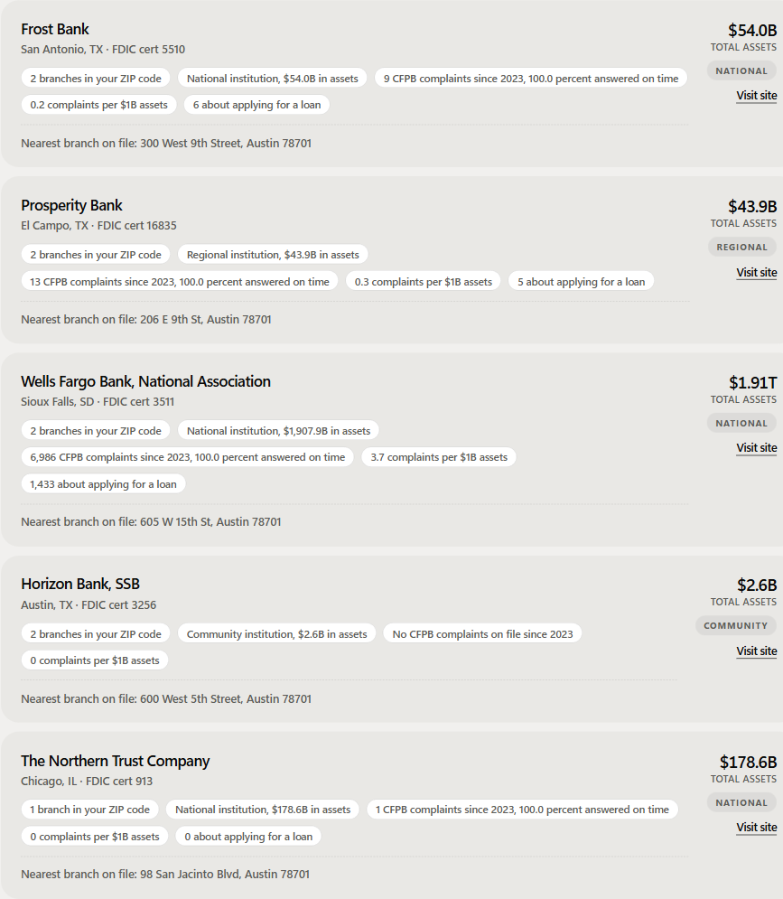
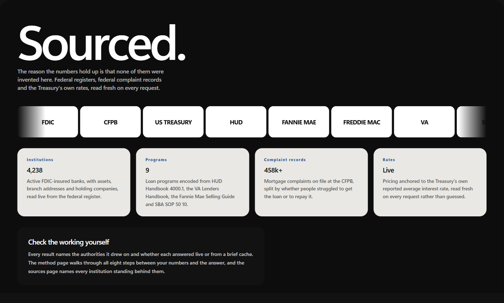
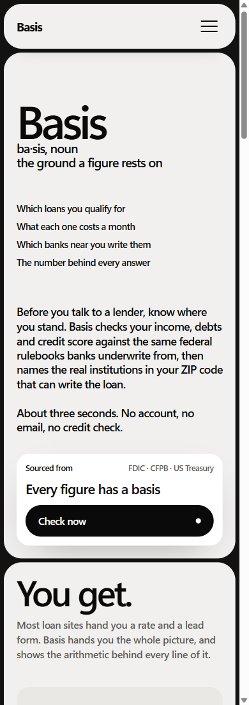

# Basis

*ba·sis, noun — the ground a figure rests on*

**Know exactly which loans you qualify for, what each one costs, and which real banks near you can write them. Before you talk to anyone.**

---

## Why it exists

Working out what you can borrow means visiting six lender sites. Every one of them wants your name, your email and your phone number before it will show you anything. What comes back is a single teaser rate with no explanation, and what follows is months of calls and mail you never asked for.

Nobody tells you *why* you got the answer you got, and nobody tells you which of those banks is actually near you or worth dealing with.

Basis answers the question without charging you your details for it.

---

## What it does

One page. No account, no email, no phone number, no credit check of any kind.

You enter what you earn, what you owe, your credit score and your ZIP code. In about three seconds:

**Every program you qualify for.** FHA, VA, USDA, conventional, jumbo, auto, personal and SBA, each checked against its published federal or GSE standard and ranked by what it costs you a month.

**The exact number behind every answer.** Never just "declined". Instead: *you are 60 points short of 620*, or *$9,900 more down brings your loan-to-value inside the cap*. Every check names your value, the limit it met, and the handbook that limit came from.

**The real banks that serve you.** Actual FDIC-insured institutions with branches in your ZIP code, with their street addresses, ranked by proximity and by how many people complained about them *while applying for a loan* rather than while repaying one.

**What you could actually borrow.** Your ceiling on income and debts alone, the monthly payment room behind it, and the date the money would realistically land once weekends and bank holidays are counted.

Then it gets out of the way. Nothing is stored, nothing is sold, and no bank is told you exist.

---

## Screens

| | |
|---|---|
|  | The proposition, in one screen. |
|  | Four deliverables. Most loan sites hand you a rate and a lead form. |
|  | Seven fields, multi-currency income, no personal details requested. |
|  | Credit band, programs open, cheapest monthly cost, borrowing ceiling. |
|  | A veteran with no deposit: VA passes every check, the other four are declined with the size of each gap. |
|  | Inside one program: every check, the cost broken out, the federal authority behind it. |
|  | Real institutions with real branch addresses and their complaint record. |
|  | Nothing invented. Federal registers, federal complaint records, Treasury rates. |
|  | Built for the phone as carefully as the desktop. |

---

## Running it

```bash
python -m venv venv
venv\Scripts\python.exe -m pip install -r requirements.txt
venv\Scripts\python.exe -m uvicorn app.main:app --port 8767
```

Or `powershell -File run.ps1`.

- Site: http://localhost:8767
- API reference: http://localhost:8767/docs
- Source health: http://localhost:8767/api/metrics

No API keys. No database. No build step. No `node_modules`.

### Checks

```bash
venv\Scripts\python.exe tests\run_all.py       # 62 tests, offline
venv\Scripts\python.exe scripts\check_apis.py  # are the upstreams alive
venv\Scripts\python.exe scripts\scenarios.py   # ten realistic applicants, end to end
```

| Suite | Covers |
|---|---|
| `test_engine` | Loan maths, the rule engine, the affordability ceiling |
| `test_matching` | Reconciling institution names across federal databases |
| `test_degradation` | What a user sees when each upstream is dead |

No test depends on a live public API succeeding. A suite that goes red because someone else's endpoint is having a bad morning is a suite people learn to ignore.

---

## Where the numbers come from

| Authority | What it provides |
|---|---|
| Federal Deposit Insurance Corporation | Active insured institutions, assets, branch addresses, holding companies |
| Consumer Financial Protection Bureau | Complaint counts per institution, split by loan stage, and timely-response rate |
| United States Treasury | The benchmark rate consumer lending is priced against |
| HUD, VA, USDA, Fannie Mae, SBA | The published underwriting standards behind every threshold |
| European Central Bank | Daily reference rates for non-USD income |
| Federal holiday calendar | The days US banks are closed |

All read live on each request. Nothing is scraped, cached indefinitely, or invented.

---

## How it holds up

**Every failure is explained with arithmetic.** A rejection says "you are 60 points short" or "about $13,799 more down would bring it inside", never just "not eligible".

**Sources degrade independently.** Each provider fails on its own without taking the page with it. The rule engine is pure arithmetic, so programs, checks and reasons render even in a total outage. A stale cached answer is served in preference to losing a feature, and labelled as cached.

**"Unavailable" is never dressed up as "none found".** A bank register returning nothing and a bank register being unreachable are different claims, and the second must never render as the first.

**Institution matching is exact or honest.** Federal databases file the same bank under charter names, holding-company names and brand names that share no words. Where an institution genuinely cannot be reconciled, it is reported as unmatched rather than handed a record belonging to someone else.

**Nothing degrades quietly.** Per-source health and the institution match rate are tracked and published at `/api/metrics`.

---

## What it holds about you

| Data | Treatment |
|---|---|
| Income, debts, credit score | Held in memory for one request, then discarded. No database, nothing written to disk, nothing logged. |
| Financial figures | Never leave the server. No credit bureau is contacted. |
| ZIP code | Sent alone to find nearby institutions, never alongside financial details. Omit it and no location leaves at all. |
| Cache | Public reference data only: institutions, rates, holidays. Never anything about the applicant. |

No sign-up, no cookie banner, no analytics, and no third-party script, stylesheet or font. The page ships a strict Content Security Policy, `X-Frame-Options: DENY`, `nosniff`, `no-referrer`, a restrictive `Permissions-Policy`, and `no-store` on every API response.

---

## Deploying

Stateless, no secrets, no database, so any container host works.

| Host | Command |
|---|---|
| Render | Connect the repo; it reads `render.yaml` |
| Fly.io | `fly launch --no-deploy` then `fly deploy` |
| Any Docker host | `docker build -t basis . && docker run -p 8767:8767 basis` |
| Heroku-style | `Procfile` included |

Runs as a non-root user, reads `PORT` from the environment, exposes `/health`. Nothing needs configuring, because no upstream requires an API key.

---

## Layout

```
app/
  config.py            every outbound endpoint, in one auditable file
  cache.py             shared HTTP client, TTL cache, metrics, log scrubbing
  models.py            request validation
  providers/           one module per data source
  engine/
    programs.py        the loan program catalog and its published thresholds
    affordability.py   amortization and ratio maths, pure functions
    eligibility.py     the rule engine, returns a verdict plus every check
    lenders.py         matches and ranks real institutions
  routers/             the API surface
web/                   the site: no framework, no build step, no inline styles
tests/                 62 tests across maths, matching and failure handling
scripts/               upstream health, realistic scenarios, asset versioning
```

---

## Notes

Layout, type scale and card system are adapted from a studio site template; everything below that layer, and all product and interaction design, is original to this project.

---

## Disclaimer

Basis produces estimates from published program rules and public data. It is not a credit decision, an approval, a pre-approval, a quote or an offer of credit, and it is not a lender, a broker or a credit bureau. No credit bureau is contacted and no credit check of any kind is performed. The institutions listed have not seen your details and have not agreed to lend to you. Individual lenders apply their own criteria on top of the published standards. Only a lender can tell you what you actually qualify for.

---

© Vijaya Vittala Gowda. All rights reserved.
